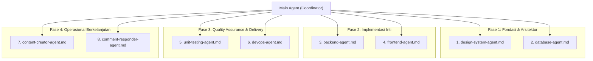

# Tim Multi-Agent NeoBlog (.agent)

Folder ini berisi spesifikasi formal, persona, prompt sistem, batasan tanggung jawab (*separation of concerns*), serta kontrak input/output untuk setiap subagen otonom dalam pengembangan dan operasional platform **NeoBlog**.

---

## 👥 Roster Agen

| File Agen | Peran Utama | Fokus Utama |
|:---|:---|:---|
| [1. design-system-agent.md](design-system-agent.md) | UI/UX Designer & CSS Architect | Design tokens, warna, tipografi, dark mode, CSS Native murni. |
| [2. database-agent.md](database-agent.md) | Database Administrator & Architect | Skema relasional 3NF MySQL, indexing performa, integritas DDL. |
| [3. backend-agent.md](backend-agent.md) | Software Engineer (PHP Native) | Router URL dinamis, MVC controller, PDO prepared statements, CSRF/XSS. |
| [4. frontend-agent.md](frontend-agent.md) | Frontend Developer (Vanilla Web) | HTML5 semantik, Fetch API asynchronous, dynamic DOM update. |
| [5. unit-testing-agent.md](unit-testing-agent.md) | QA Automation Engineer | Test runner mandiri PHP & JS tanpa dependensi luar (zero framework). |
| [6. devops-agent.md](devops-agent.md) | Release & CI/CD Specialist | Git versioning, `.gitignore`, GitHub Actions CI pipeline. |
| [7. content-creator-agent.md](content-creator-agent.md) | Content Strategist & Writer | Riset topik, penyusunan artikel terformat, publikasi harian otomatis. |
| [8. comment-responder-agent.md](comment-responder-agent.md) | Community Moderator & AI Responder | Anti-spam filtering, analisis sentimen, perumusan balasan cerdas. |

---

## ⚙️ Prinsip Kerja Sama Antar-Agen
1. **Zero External Dependencies**: Tidak ada agen yang diperkenankan menambahkan library atau framework pihak ketiga (tanpa Composer/NPM).
2. **Interface Contracts**: Setiap agen membaca artefak yang dihasilkan agen sebelumnya sebagai kontrak (misalnya: Backend Agent mengacu pada `database/schema.sql` dan `public/assets/css/variables.css`).
3. **Idempotensi & Keamanan**: Seluruh skrip migrasi, DDL, dan runner harus aman dijalankan berulang kali (*idempotent*) dan mematuhi kaidah keamanan OWASP.
