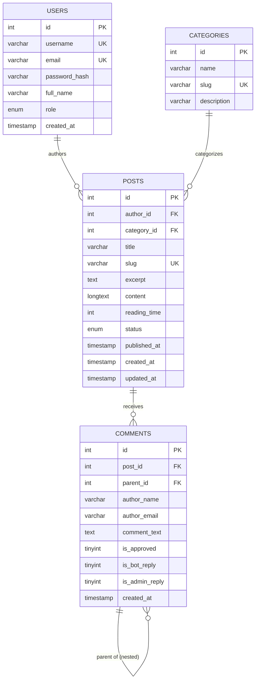

# NeoBlog 🚀

> **High-Performance, Zero-Dependency Blog Platform Built with Native PHP, MySQL, Vanilla CSS & Vanilla JavaScript, Featuring a Full-Featured Admin CMS Dashboard & Orchestrated by Multi-Agent Systems in Google Antigravity.**

[](https://www.php.net/)
[](https://www.mysql.com/)
[](https://developer.mozilla.org/)
[](tests/)
[](https://deepmind.google/)
[](.github/workflows/ci.yml)
[](LICENSE)

---

## 📑 Daftar Isi

- [1. Filosofi & Gambaran Umum](#1-filosofi--gambaran-umum)
- [2. Arsitektur Multi-Agent di Antigravity](#2-arsitektur-multi-agent-di-antigravity)
- [3. Fitur Utama](#3-fitur-utama)
- [4. Dashboard CMS & Panel Admin](#4-dashboard-cms--panel-admin)
- [5. Struktur Direktori Proyek](#5-struktur-direktori-proyek)
- [6. Skema Basis Data & ERD](#6-skema-basis-data--erd)
- [7. Arsitektur Keamanan (Security Hardening)](#7-arsitektur-keamanan-security-hardening)
- [8. Panduan Instalasi & Penggunaan](#8-panduan-instalasi--penggunaan)
- [9. Kerangka Pengujian Mandiri (Native Unit & E2E Testing)](#9-kerangka-pengujian-mandiri-native-unit--e2e-testing)
- [10. Otomatisasi Agen Otonom (Content & Comments)](#10-otomatisasi-agen-otonom-content--comments)
- [11. Pipeline CI/CD GitHub Actions](#11-pipeline-cicd-github-actions)
- [12. Konvensi Kode & Kontribusi](#12-konvensi-kode--kontribusi)
- [13. Lisensi](#-lisensi)

---

## 1. Filosofi & Gambaran Umum

Dalam lanskap pengembangan web modern, tumpukan teknologi sering kali terbebani oleh ratusan pustaka pihak ketiga (*npm bloat*, *vendor dependencies*, bundler kompleks, dan abstraksi berlebihan) yang memperlambat *time-to-first-byte* (TTFB) dan memperluas permukaan kerentanan keamanan (*supply chain attacks*).

**NeoBlog** dirancang dengan prinsip **Back to Foundations, Engineered for the Future**:
1. **100% Native & Zero External Dependencies**: Tidak menggunakan framework PHP (tanpa Laravel/Symfony), tanpa framework CSS (tanpa Tailwind/Bootstrap), tanpa library JS (tanpa React/Vue/jQuery), dan tanpa test harness pihak ketiga (tanpa PHPUnit/Jest).
2. **Kinerja Ekstrim**: Waktu respons server (TTFB) sub-20ms dengan alokasi memori sangat minimal (< 2MB per request).
3. **Desain Modular MVC/Front Controller**: Kode tersusun secara terstruktur, terisolasi, dan mudah dipelihara.
4. **Digerakkan oleh Multi-Agent Systems**: Setiap aspek sistem dikembangkan dan diverifikasi oleh agen AI spesialis otonom.

---

## 2. Arsitektur Multi-Agent di Antigravity

Proyek ini dibangun melalui kolaborasi **Multi-Agent Systems** di lingkungan Google Antigravity:

```mermaid
flowchart TD
    Coordinator["Main Coordinator / Project Lead"]

    subgraph "Fase 1: Fondasi & Arsitektur"
        DesignAgent["Design System Specialist<br/>(CSS Variables, Grid, Dark Mode)"]
        DBAgent["Database Architect<br/>(MySQL 3NF, Indexing, Seeds)"]
    end

    subgraph "Fase 2: Implementasi Inti & CMS"
        BackendAgent["Backend Specialist (PHP Native)<br/>(Router, PDO, CSRF, RBAC, Controllers)"]
        FrontendAgent["Frontend Specialist (JS/CSS Native)<br/>(DOM, Admin UI, AJAX Fetch, Responsive)"]
    end

    subgraph "Fase 3: Jaminan Kualitas & Verifikasi Ketat"
        TestAgent["Testing Track Orchestrator<br/>(Custom PHP, JS & 153 E2E Tests)"]
        AuditorAgent["Forensic Auditor & Challenger<br/>(Static, Boundary & Adversarial Checks)"]
        DevOpsAgent["DevOps Specialist<br/>(Git, CI/CD Actions)"]
    end

    subgraph "Fase 4: Operasional Berkelanjutan"
        ContentAgent["Content Creator Agent<br/>(Daily Automated Article Generator)"]
        CommentAgent["Comment Responder Agent<br/>(Anti-Spam & Auto-Reply AI)"]
    end

    Coordinator --> DesignAgent
    Coordinator --> DBAgent
    Coordinator --> BackendAgent
    Coordinator --> FrontendAgent
    Coordinator --> TestAgent
    Coordinator --> AuditorAgent
    Coordinator --> DevOpsAgent
    Coordinator --> ContentAgent
    Coordinator --> CommentAgent
```



---

## 3. Fitur Utama

- ⚡ **Kecepatan Instan**: Rendering sisi server murni tanpa lapisan kompilasi view engine.
- 🎛️ **Dashboard CMS Khusus Admin**: Pengelolaan penuh draf artikel, status publikasi, dan antrean moderasi komentar.
- 🔐 **Autentikasi Sesi & Role-Based Access Control (RBAC)**: Proteksi multi-level untuk `admin`, `editor`, dan `author` dengan regenerasi ID sesi dan penolakan otomatis role tanpa hak akses.
- 📝 **Manajemen Siklus Hidup Artikel**: Dukungan draf, pratinjau, publikasi instan, pengarsipan, pembuatan slug otomatis (*auto-slug*), dan pembersihan markup HTML.
- 🛡️ **Moderasi Komentar Real-Time**: Antrean moderasi terpisah (*pending* vs *approved*), persetujuan/penyembunyian instan, balasan admin bertingkat dengan lencana khusus, serta *cascade delete*.
- 🌓 **Tema Gelap / Terang (Dark/Light Mode)**: Menggunakan CSS Custom Properties dengan persistensi otomatis via `localStorage` dan sinkronisasi preferensi OS (`prefers-color-scheme`).
- 💬 **Komentar Asynchronous (No-Reload)**: Pengiriman komentar menggunakan Fetch API Vanilla JavaScript dengan penyisipan langsung ke DOM tanpa me-refresh halaman.
- 🧵 **Komentar Berjenjang (Threaded/Nested Replies)**: Mendukung balasan berjenjang antar pembaca dan balasan resmi admin/bot.
- 🛡️ **Keamanan Berlapis (Defense-in-Depth)**: Bebas dari risiko umum OWASP Top 10 (SQLi via PDO Prepared Statements, XSS via sanitizer ganda, dan CSRF token terenkripsi).
- 🤖 **Operasional Harian Otonom**: Script CLI siap pakai untuk auto-publish artikel harian dan auto-reply interaksi komunitas.
- 🧪 **Zero-Dependency Test Suite**: 28 PHP Unit Tests, 6 JS Unit Tests, dan 153 Native E2E Tests yang berjalan otomatis tanpa dependensi luar.

---

## 4. Dashboard CMS & Panel Admin

NeoBlog dilengkapi panel administrasi komprehensif untuk pengelola situs:

### 1. Rute & Akses Admin
- **Halaman Login**: `/admin/login` (alias: `/login`)
- **Dashboard Ringkasan**: `/admin`
- **Manajemen Artikel**: `/admin/posts`
- **Form Buat Artikel**: `/admin/posts/create`
- **Form Edit Artikel**: `/admin/posts/{id}/edit`
- **Moderasi Komentar**: `/admin/comments`
- **Logout Aman**: `/admin/logout` (POST berproteksi CSRF)

### 2. Akun Bawaan (Default Credentials)

| Role | Username | Email | Password | Hak Akses |
| :--- | :--- | :--- | :--- | :--- |
| **Admin** | `admin` | `admin@neoblog.local` | `admin123` | Akses penuh dashboard, artikel, dan moderasi komentar |
| **Editor** | `editor` | `editor@neoblog.local` | `editor123` | Akses penuh pengelolaan artikel dan moderasi komentar |
| **Author** | `author` | `author@neoblog.local` | `author123` | Penulis konten publik; akses ke CMS ditolak (403 Forbidden) |

### 3. Kemampuan Pengelolaan Draf Artikel
- **Penyaringan & Pencarian**: Filter artikel berdasarkan tab status (`Semua`, `Draft`, `Published`, `Archived`) dan pencarian kata kunci judul/isi.
- **Formulir Terpadu**: Pembuatan dan penyuntingan artikel dengan pemilihan kategori, estimasi waktu baca otomatis/manual, pembuatan slug URL-safe otomatis dengan pencegahan duplikasi, dan sanitasi HTML via `Sanitizer::cleanHtml()`.
- **Transisi Cepat (Quick Status)**: Mengubah status artikel (`draft` $\leftrightarrow$ `published` $\leftrightarrow$ `archived`) secara langsung dari daftar tabel, baik menggunakan form submission standar maupun asinkron (AJAX JSON).
- **Penghapusan Aman**: Menghapus artikel beserta integritas pembersihan relasi komentar.

### 4. Kemampuan Moderasi Komentar
- **Antrean Moderasi Terpisah**: Tab khusus untuk memfilter komentar `Semua`, `Menunggu / Disembunyikan` (pending), dan `Disetujui` (approved).
- **Setujui & Sembunyikan**: Menyetujui komentar agar tampil di halaman publik atau menyembunyikan komentar yang tidak pantas tanpa menghapus riwayat.
- **Balas Komentar (Admin Reply)**: Admin/editor dapat langsung membalas komentar pengunjung. Pada halaman publik, balasan admin akan muncul bertingkat dengan lencana khusus `Admin` atau `Editor` (berbeda dengan lencana bot `Assistant`).
- **Cascade Delete**: Menghapus komentar induk secara otomatis akan membersihkan seluruh balasan anak di bawahnya.
- **Privasi Pengunjung**: Alamat email komentator hanya dapat dilihat oleh admin/editor di dashboard dan tidak pernah diekspos ke publik.

---

## 5. Struktur Direktori Proyek

```text
neoblog/
├── .github/
│   └── workflows/
│       └── ci.yml               # Pipeline CI GitHub Actions untuk test otomatis
├── config/
│   ├── app.php                  # Konfigurasi konstanta global & session
│   └── database.php             # Database singleton connection berbasis PDO
├── database/
│   ├── schema.sql               # Skema DDL tabel MySQL lengkap dengan index
│   └── seed.sql                 # Data seeder akun admin/editor/author, kategori, artikel & komentar
├── docs/                        # Dokumentasi arsitektur, prompt teamwork, & spesifikasi
├── public/                      # Document Root publik
│   ├── assets/
│   │   ├── css/
│   │   │   ├── variables.css    # Design tokens & color variables (dark/light)
│   │   │   └── style.css        # Tata letak CSS Grid/Flexbox responsif & styling admin
│   │   └── js/
│   │       ├── admin.js         # Interaktivitas Dashboard CMS & AJAX handler
│   │       ├── comments.js      # AJAX Fetch API komentar publik & live DOM rendering
│   │       ├── main.js          # Controller tema dan interaktivitas global
│   │       └── utils.js         # Utilitas vanilla JS (XSS escaping, validasi, slugify)
│   └── index.php                # Front controller / single entry point
├── scripts/
│   ├── daily_content.php        # Autonomous Content Creator Agent runner
│   └── reply_comments.php       # Autonomous Comment Responder Agent runner
├── src/
│   ├── Controllers/             # Controller penangan rute HTTP
│   │   ├── AdminCommentController.php # Moderasi komentar admin (approve, hide, reply, delete)
│   │   ├── AdminController.php        # Halaman utama ringkasan dashboard CMS
│   │   ├── AdminPostController.php    # Manajemen siklus draf & publikasi artikel
│   │   ├── AuthController.php         # Penangan login sesi & logout admin
│   │   ├── CommentController.php      # API endpoint komentar publik (AJAX)
│   │   └── PostController.php         # Beranda dan detail artikel publik
│   ├── Models/                  # Model data berorientasi objek (PDO)
│   │   ├── Category.php         # Kueri kategori artikel
│   │   ├── Comment.php          # Kueri komentar, status moderasi, balasan admin
│   │   ├── Post.php             # Kueri artikel, filter draf/arsip, pencarian admin
│   │   └── User.php             # Kueri pengguna & verifikasi password hash
│   ├── Utils/                   # Komponen utilitas keamanan & helper
│   │   ├── Auth.php             # Pengelola sesi autentikasi & RBAC
│   │   ├── CSRF.php             # Generator & validator token anti-CSRF (Form & Header)
│   │   ├── Response.php         # Helper respons JSON & redirect HTTP
│   │   └── Sanitizer.php        # Pembersih XSS, sanitizer HTML artikel, validator email
│   └── Router.php               # URL Router vanilla berbasis pola regex
├── tests/
│   ├── e2e/                     # Suite Pengujian Opaque-Box E2E Native
│   │   ├── lib/                 # Harness DB sementara (ephemeral MySQL), HTTP client, server runner
│   │   ├── tiers/
│   │   │   ├── tier1_features.js     # Tier 1: 64 pengujian cakupan fitur
│   │   │   ├── tier2_boundaries.js   # Tier 2: 68 pengujian batasan & keamanan
│   │   │   ├── tier3_combinations.js # Tier 3: 14 pengujian kombinasi lintas fitur
│   │   │   └── tier4_workflows.js    # Tier 4: 7 skenario alur kerja nyata & browser CDP
│   │   └── runner.js            # E2E Test Runner native
│   ├── js/
│   │   └── runner.js            # JavaScript Native unit test runner (6 tests)
│   └── php/
│       ├── AdminCommentTest.php # Unit test moderasi komentar & balasan admin
│       ├── AdminPostTest.php    # Unit test siklus draf artikel & auto-slug
│       ├── CSRFTest.php         # Unit test validasi token CSRF
│       ├── RouterTest.php       # Unit test dispatching URL & HTTP methods
│       ├── SanitizerTest.php    # Unit test sanitasi XSS & slugify
│       └── runner.php           # PHP Native unit test runner (28 tests)
├── .gitignore                   # Konfigurasi proteksi file sensitif & OS
├── README.md                    # Dokumentasi komprehensif proyek ini
```

---

## 6. Skema Basis Data & ERD

Sistem basis data dirancang dalam bentuk normal ketiga (3NF) untuk mencegah redundansi data dan memaksimalkan kecepatan pembacaan (*high-read traffic*):



### Strategi Pengindeksan:
- `posts.slug` (`idx_posts_slug`): Indeks unik untuk resolusi URL artikel seketika (O(log n)).
- `posts (status, published_at)` (`idx_posts_status_published`): Indeks gabungan (*composite index*) untuk optimasi query feed publik dan filter status di admin.
- `comments (post_id, created_at)` (`idx_comments_post`): Mengoptimalkan pengambilan riwayat komentar per artikel secara kronologis.
- `comments.status` & `comments.is_approved`: Mengoptimalkan pemfilteran antrean komentar pada dashboard moderasi.

---

## 7. Arsitektur Keamanan (Security Hardening)

NeoBlog menerapkan pertahanan berlapis (*defense-in-depth*):

### 1. Perlindungan Mutlak Terhadap SQL Injection
Seluruh interaksi basis data wajib menggunakan **PDO Prepared Statements** dengan parameter binding terpisah:
```php
$stmt = $pdo->prepare("SELECT * FROM posts WHERE slug = :slug AND status = 'published' LIMIT 1");
$stmt->execute([':slug' => $slug]);
```
Emulasi prepare PDO dinonaktifkan (`PDO::ATTR_EMULATE_PREPARES => false`) agar validasi tipe data dilakukan langsung di engine database.

### 2. Sanitasi XSS Berlapis
- **Input Teks Biasa**: Dibersihkan menggunakan fungsi `Sanitizer::clean()` (`htmlspecialchars` dengan flag `ENT_QUOTES | ENT_SUBSTITUTE, 'UTF-8'`).
- **Konten HTML Artikel**: Menggunakan `Sanitizer::cleanHtml()` yang hanya mengizinkan tag konten aman (`<p>`, `<h1>`-`<h6>`, `<ul>`, `<ol>`, `<li>`, `<a>`, `<blockquote>`, `<code>`, `<pre>`, `<strong>`, `<em>`, `<hr>`) dan membersihkan tag berbahaya seperti `<script>`, `<iframe>`, serta atribut event javascript (`onload`, `onclick`, dll).

### 3. Mitigasi CSRF (Cross-Site Request Forgery)
Setiap formulir mutasi data (`POST`) wajib memverifikasi token kriptografis 64-karakter hex:
```php
// Verifikasi ganda: mendukung form POST dan header HTTP X-CSRF-Token (untuk request AJAX)
CSRF::validateRequest();
```
Verifikasi menggunakan `hash_equals()` untuk mencegah serangan berbasis waktu (*timing attacks*).

### 4. Proteksi Sesi & Akses RBAC
- Regenerasi ID sesi (`session_regenerate_id(true)`) saat login berhasil untuk mencegah *Session Fixation*.
- Cookie sesi dikonfigurasi dengan flag `HttpOnly`, `SameSite=Lax`, dan `Secure` (pada HTTPS).
- Pemeriksaan hak akses peran via `Auth::requireAdminOrEditor()` yang menolak akses guest (redirect 302 / JSON 401) dan author (JSON/HTML 403).

---

## 8. Panduan Instalasi & Penggunaan

### Prasyarat Sistem
- **PHP**: Versi 8.1 atau lebih baru (ekstensi aktif: `pdo_mysql`, `mbstring`, `iconv`).
- **MySQL**: Versi 8.0+ atau MariaDB 10.4+.
- **Node.js**: Versi 18+ (untuk menjalankan test runner JavaScript dan E2E suite).

### Langkah 1: Clone atau Buka Direktori Proyek
```bash
git clone https://github.com/cahyadsn/neoblog.git
cd neoblog
```

### Langkah 2: Konfigurasi Basis Data
Eksekusi script skema dan seeder ke MySQL:
```sql
-- Buat database dan tabel
SOURCE database/schema.sql;

-- Masukkan data awal (akun admin/editor, kategori, artikel, dan komentar)
SOURCE database/seed.sql;
```

*Kredensial Default Basis Data:*
- Host: `localhost:3306`
- Database: `neoblog`
- User: `root`
- Password: *(kosong)*

### Langkah 3: Menjalankan Server Pengembangan Lokal
Jalankan web server bawaan PHP yang mengarah ke folder `public`:
```bash
php -S localhost:8000 -t public
```
- Buka beranda publik: 👉 **[http://localhost:8000](http://localhost:8000)**
- Buka Dashboard CMS Admin: 👉 **[http://localhost:8000/admin/login](http://localhost:8000/admin/login)** *(Gunakan `admin` / `admin123`)*

---

## 9. Kerangka Pengujian Mandiri (Native Unit & E2E Testing)

NeoBlog dilengkapi kerangka pengujian mandiri 100% native tanpa PHPUnit, Jest, atau Cypress:

### 1. Menjalankan Unit Test PHP (28 Tests)
```bash
php tests/php/runner.php
```
Mencakup pengujian Sanitizer (XSS, slugify, cleanHtml), CSRF (POST & Header), Router Regex, User Auth, Post Lifecycle, Comment Moderation, dan View Rendering.

### 2. Menjalankan Unit Test JavaScript (6 Tests)
```bash
node tests/js/runner.js
```
Mencakup pengujian utilitas frontend: `escapeHtml`, `nl2brSafe`, `validateEmail`, dan `slugifyTitle`.

### 3. Menjalankan Pengujian Menyeluruh E2E (153 Tests)
Harness E2E secara otomatis menjalankan instans basis data MySQL terisolasi dan server PHP sementara:
```bash
# Menjalankan seluruh 153 tes E2E
node tests/e2e/runner.js

# Menjalankan per tier pengujian
node tests/e2e/runner.js --tier=1   # Tier 1: Feature Coverage (64 tests)
node tests/e2e/runner.js --tier=2   # Tier 2: Boundaries & Security (68 tests)
node tests/e2e/runner.js --tier=3   # Tier 3: Cross-Feature Combinations (14 tests)
node tests/e2e/runner.js --tier=4   # Tier 4: End-to-End Workflows & Browser CDP (7 tests)

# Menjalankan uji mandiri harness
node tests/e2e/runner.js --self-check
```

*Hasil Pengujian:*
```text
============================================
 Hasil Pengujian E2E Native NeoBlog
============================================
 Tier 1: Feature Coverage           : 64/64 PASS
 Tier 2: Boundaries & Security      : 68/68 PASS
 Tier 3: Cross-Feature Combinations : 14/14 PASS
 Tier 4: End-to-End Workflows       : 7/7 PASS
--------------------------------------------
 Total Test : 153
 Berhasil   : 153
 Gagal      : 0
============================================
```

---

## 10. Otomatisasi Agen Otonom (Content & Comments)

NeoBlog menyediakan dua agen otomatisasi berbasis script CLI yang siap dihubungkan dengan penjadwal tugas (*cron / scheduler*):

### 1. Content Creator / Writer Agent (`scripts/daily_content.php`)
```bash
# Menjalankan posting harian otomatis
php scripts/daily_content.php

# Menjalankan posting dengan topik spesifik
php scripts/daily_content.php "Panduan Keamanan Web API Menggunakan PHP Native"
```

### 2. Comment Responder & Moderator Agent (`scripts/reply_comments.php`)
```bash
# Menjalankan pemindaian dan auto-reply komentar komunitas
php scripts/reply_comments.php
```

---

## 11. Pipeline CI/CD GitHub Actions

Setiap commit atau pull request ke branch `main` divalidasi oleh GitHub Actions pada `.github/workflows/ci.yml`:
1. Menyiapkan environment Ubuntu Linux terbaru.
2. Memasang PHP 8.3 dengan ekstensi `pdo`, `pdo_mysql`, `mbstring`.
3. Memasang Node.js 20.
4. Menjalankan `php tests/php/runner.php`.
5. Menjalankan `node tests/js/runner.js`.

---

## 12. Konvensi Kode & Kontribusi

- **Arsitektur**: Tetap pertahankan prinsip 100% zero external dependencies (tanpa pustaka `vendor` pihak ketiga atau paket `npm`).
- **PHP Style**: Mengikuti standar PSR-12, tipe data terdefinisi (`declare(strict_types=1)`), dan PDO prepared statements.
- **Frontend**: Gunakan Vanilla JavaScript (ES6+) dan CSS modern (CSS Variables, Flexbox, Grid).

---

## 📄 Lisensi

Proyek ini dilisensikan di bawah lisensi terbuka [MIT](LICENSE).

---

*Dikembangkan dengan presisi arsitektur oleh Google Antigravity Multi-Agent Systems.*
