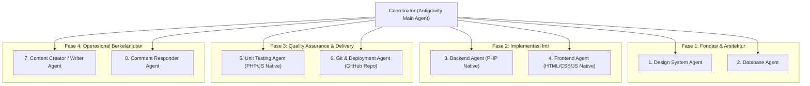

# Cetak Biru Proyek: NeoBlog v1 (Multi-Agent Architecture)

Dokumen ini berisi panduan komprehensif, arsitektur, dan langkah demi langkah implementasi aplikasi web blog modern berbasis **PHP Native** dan **MySQL** (dengan **CSS Native**, **JavaScript Vanilla**, serta custom **Unit Testing Native**), yang dibangun dan dikelola menggunakan sistem **Multi-Agent di Antigravity**.

---

## 1. Arsitektur Tim Multi-Agent

Dalam ekosistem Antigravity, **Main Agent (Coordinator)** bertindak sebagai Technical Lead & Project Coordinator yang mendelegasikan tugas ke subagent spesialis. Setiap agen bekerja berdasarkan batasan tanggung jawab (*separation of concerns*) yang jelas.



---

## 2. Roster & Spesifikasi Agen

| No | Nama Agen | Peran Utama | Lingkup & Artefak yang Dihasilkan |
|:---|:---|:---|:---|
| 1 | `design-system-agent` | UI/UX Designer & CSS Architect | Merancang *design tokens*, warna, tipografi, grid responsif, dark mode, dan file CSS murni (`variables.css`, `style.css`). |
| 2 | `database-agent` | Database Administrator / Architect | Merancang skema relasional 3NF MySQL, indexing performa, integritas referensial (foreign keys), migrasi SQL, dan data awal (*seeds*). |
| 3 | `backend-agent` | Software Engineer (PHP Native) | Membangun MVC/Action-Domain-Responder sederhana: Router berbasis path URL, PDO singleton wrapper, prepared statements, sesi autentikasi, proteksi CSRF & XSS. |
| 4 | `frontend-agent` | UI/UX Developer (Vanilla Web) | Membangun HTML5 semantik dan interaktivitas JavaScript ES6+ murni (AJAX via `fetch()` untuk form komentar tanpa reload, dark mode toggle, mobile navigation). |
| 5 | `unit-testing-agent` | QA & Test Automation Specialist | Mengembangkan micro test runner mandiri untuk PHP dan JavaScript murni tanpa library pihak ketiga (PHPUnit/Jest). |
| 6 | `devops-agent` | Release & Infrastructure Specialist | Inisialisasi Git, `.gitignore`, penataan commit convention, pembuatan repositori via GitHub CLI (`gh`), dan setup CI/CD workflow GitHub Actions. |
| 7 | `content-creator-agent` | Content Strategist & Writer | Riset topik harian, drafting artikel berformat Markdown/HTML lengkap dengan meta tag SEO (title, slug, excerpt, reading time), dan eksekusi penerbitan berkala. |
| 8 | `comment-responder-agent` | Community Moderator & AI Responder | Memfilter komentar spam, menganalisis sentimen komentar, dan merumuskan balasan solutif/kontekstual dari sisi admin. |

---

## 3. Struktur Direktori Proyek

```text
neoblog/
├── config/
│   ├── database.php        # Konfigurasi koneksi PDO MySQL Singleton
│   └── app.php             # Pengaturan konstanta global & environment
├── database/
│   ├── schema.sql          # DDL tabel (users, posts, categories, comments)
│   └── seed.sql            # Data akun default dan artikel awal
├── docs/
│   ├── neoblog_draft_v1.md # Cetak biru spesifikasi proyek ini
│   └── design-guidelines.md# Dokumentasi token desain & komponen UI
├── public/
│   ├── index.php           # Front Controller / Single Entry Point
│   ├── assets/
│   │   ├── css/
│   │   │   ├── variables.css # Design tokens & CSS custom properties
│   │   │   └── style.css     # CSS Native (Reset, Flexbox/Grid, Components)
│   │   └── js/
│   │       ├── main.js       # Navigasi responsif & Theme Toggle
│   │       └── comments.js   # AJAX form submit komentar
├── src/
│   ├── Controllers/        # PostController, CommentController, AuthController
│   ├── Models/             # Post, Comment, User (PDO logic)
│   ├── Utils/              # Sanitizer, CSRF, Session, ViewRenderer
│   └── Router.php          # Vanilla PHP Request Router
├── views/
│   ├── layouts/
│   │   └── main.php        # Kerangka layout utama
│   ├── posts/
│   │   ├── index.php       # Beranda & daftar posting
│   │   └── detail.php      # Halaman artikel & kolom komentar
│   └── admin/              # Halaman manajemen konten (CRUD)
├── tests/
│   ├── php/
│   │   ├── runner.php      # Native PHP Test Runner
│   │   └── SanitizerTest.php
│   └── js/
│       ├── runner.js       # Native JS Test Runner
│       └── utils.test.js
├── scripts/
│   ├── daily_content.php   # Otomatisasi posting harian
│   └── reply_comments.php  # Otomatisasi moderasi & auto-reply komentar
├── .github/
│   └── workflows/
│       └── ci.yml          # GitHub Actions Test Pipeline
├── .gitignore
└── README.md
```

---

## 4. Rincian Implementasi per Fase

### Fase 1: Desain Sistem & Skema Database

#### A. Desain Sistem (CSS Native)
Dibuat tanpa framework CSS (seperti Bootstrap/Tailwind) agar ringan dan cepat:
- Menggunakan **CSS Custom Properties** (Variables) untuk warna, ukuran font, dan tema terang/gelap (*light/dark mode*).
- Tata letak menggunakan **CSS Grid** untuk feed artikel dan **Flexbox** untuk komponen navbar dan komentar.

#### B. Skema Database MySQL (`database/schema.sql`)
```sql
CREATE TABLE IF NOT EXISTS users (
    id INT AUTO_INCREMENT PRIMARY KEY,
    username VARCHAR(50) NOT NULL UNIQUE,
    email VARCHAR(100) NOT NULL UNIQUE,
    password_hash VARCHAR(255) NOT NULL,
    created_at TIMESTAMP DEFAULT CURRENT_TIMESTAMP
) ENGINE=InnoDB DEFAULT CHARSET=utf8mb4 COLLATE=utf8mb4_unicode_ci;

CREATE TABLE IF NOT EXISTS posts (
    id INT AUTO_INCREMENT PRIMARY KEY,
    author_id INT NOT NULL,
    title VARCHAR(255) NOT NULL,
    slug VARCHAR(255) NOT NULL UNIQUE,
    excerpt TEXT NULL,
    content LONGTEXT NOT NULL,
    status ENUM('draft', 'published') DEFAULT 'draft',
    published_at TIMESTAMP NULL,
    created_at TIMESTAMP DEFAULT CURRENT_TIMESTAMP,
    updated_at TIMESTAMP DEFAULT CURRENT_TIMESTAMP ON UPDATE CURRENT_TIMESTAMP,
    FOREIGN KEY (author_id) REFERENCES users(id) ON DELETE CASCADE,
    INDEX idx_slug (slug),
    INDEX idx_status_date (status, published_at)
) ENGINE=InnoDB DEFAULT CHARSET=utf8mb4 COLLATE=utf8mb4_unicode_ci;

CREATE TABLE IF NOT EXISTS comments (
    id INT AUTO_INCREMENT PRIMARY KEY,
    post_id INT NOT NULL,
    author_name VARCHAR(100) NOT NULL,
    author_email VARCHAR(100) NOT NULL,
    comment_text TEXT NOT NULL,
    parent_id INT NULL,
    is_approved TINYINT(1) DEFAULT 1,
    created_at TIMESTAMP DEFAULT CURRENT_TIMESTAMP,
    FOREIGN KEY (post_id) REFERENCES posts(id) ON DELETE CASCADE,
    FOREIGN KEY (parent_id) REFERENCES comments(id) ON DELETE CASCADE,
    INDEX idx_post_created (post_id, created_at)
) ENGINE=InnoDB DEFAULT CHARSET=utf8mb4 COLLATE=utf8mb4_unicode_ci;
```

---

### Fase 2: Backend (PHP Native) & Frontend (JS Native)

1. **Keamanan Backend**:
   - Seluruh kueri wajib menggunakan **PDO Prepared Statements** untuk mencegah SQL Injection.
   - Proteksi XSS melalui helper output sanitasi: `htmlspecialchars($data, ENT_QUOTES, 'UTF-8')`.
   - Proteksi CSRF menggunakan token unik berbasis sesi pada setiap formulir mutasi data (`POST`, `PUT`, `DELETE`).
2. **Interaktivitas Frontend**:
   - Komentar dikirim secara asynchronous menggunakan `fetch()` API tanpa reload halaman.
   - Penanganan respons JSON untuk langsung merender komentar baru ke DOM.

---

### Fase 3: Testing & DevOps

1. **Unit Test PHP Native**:
   Menggunakan kelas mandiri `TestRunner` yang memanfaatkan `try/catch` dan *assertions* sederhana untuk menguji fungsi utilitas sanitasi, validasi email, dan pembuatan slug.
2. **Git & GitHub Integration**:
   - Inisialisasi repositori Git lokal.
   - Integrasi langsung dengan akun pengguna melalui GitHub CLI (`gh`).
   - Setup GitHub Actions workflow `.github/workflows/ci.yml` yang menjalankan skrip `php tests/php/runner.php` pada event `push` dan `pull_request`.

---

### Fase 4: Otomatisasi Operasional Harian

#### 1. Agent Content Creator (Daily Posting)
- Berjalan via cron job/scheduler setiap hari pada jadwal yang ditentukan.
- Menjalankan script `scripts/daily_content.php`:
  1. Mengambil ide topik terkini atau antrean konten.
  2. Menghasilkan konten artikel lengkap dengan format markdown/HTML yang terstruktur.
  3. Memasukkan artikel langsung ke tabel `posts` dengan status `published`.

#### 2. Agent Comment Responder & Moderasi
- Berjalan secara periodik (misal setiap 1-2 jam) via `scripts/reply_comments.php`:
  1. Mengambil komentar yang belum diproses (`is_approved = 1` dan belum memiliki balasan dari admin).
  2. Melakukan evaluasi anti-spam (link berbahaya, kata kasar).
  3. Menghasilkan balasan kontekstual dan menyimpannya sebagai *nested comment* (`parent_id = comment.id`) dengan nama akun `Admin / AI Assistant`.

---

## 5. Ringkasan Status Dokumen
- **Versi**: 1.0 (Draft)
- **Status**: Siap untuk eksekusi implementasi bertahap bersama tim agen.
- **Lokasi File**: `docs/neoblog_draft_v1.md`
