# Rencana Implementasi: NeoBlog (PHP & MySQL Native Multi-Agent)

Dokumen ini adalah rencana teknis untuk membangun aplikasi blog modular berbasis **PHP Native** dan **MySQL** (dengan **CSS Native**, **JavaScript Vanilla**, serta custom **Unit Testing Native**) menggunakan arsitektur **Multi-Agent di Antigravity**.

---

## Deskripsi Tujuan
Membangun sistem blog yang mandiri (tanpa dependensi framework/library luar), aman (proteksi CSRF, XSS, SQLi), responsif, serta dilengkapi arsitektur multi-agent untuk pengembangan dan operasional harian (posting konten harian dan auto-reply komentar).

---

## User Review Required
> [!IMPORTANT]
> - **Kredensial Database**: Default koneksi MySQL yang akan digunakan dalam pengembangan lokal adalah `host=localhost`, `port=3306`, `dbname=neoblog`, `user=root`, `password=""`. Pengguna dapat menyesuaikan konfigurasi di `config/database.php` atau `.env.local.php`.
> - **GitHub Repository**: Tool `gh` (GitHub CLI) belum terpasang di mesin lokal. Proses deployment akan menggunakan `git` standar (`git remote add origin <URL>` dan `git push`). Pengguna dapat membuat repositori kosong di GitHub dan memberikan URL remote saat fase deployment.
> - **Eksekusi Content Creator & Comment Responder**: Otomatisasi agen harian akan disediakan dalam bentuk skrip CLI independen (`scripts/daily_content.php` dan `scripts/reply_comments.php`) yang dapat dipicu manual atau dijalankan via Windows Task Scheduler / Cron / Antigravity Schedule.

---

## Pertanyaan Terbuka & Keputusan Desain
> [!NOTE]
> 1. Apakah Anda ingin database MySQL langsung diisi dengan contoh konten awal (seeding 3 artikel dan 1 akun admin default)?
> 2. Untuk *Content Creator Agent* dan *Comment Responder Agent*, apakah Anda ingin skrip menggunakan template respons internal berbasis aturan heuristik/lokal terlebih dahulu, atau ingin disiapkan hook untuk integrasi LLM API?

---

## Struktur Tim Agen & Alur Kolaborasi

```mermaid
flowchart TD
    Coordinator["Main Agent (Coordinator)"]

    subgraph "Fase 1: Fondasi"
        DesignAgent["Design System Agent<br/>(tokens, responsive layout, dark mode)"]
        DBAgent["Database Agent<br/>(schema.sql, indexing, seeders)"]
    end

    subgraph "Fase 2: Inti Aplikasi"
        BackendAgent["Backend Agent (PHP Native)<br/>(Router, PDO, CSRF, Controllers, Auth)"]
        FrontendAgent["Frontend Agent (JS/CSS Native)<br/>(DOM render, fetch AJAX, interactive comment)"]
    end

    subgraph "Fase 3: Validasi & Rilis"
        TestAgent["Unit Testing Agent<br/>(Custom PHP & JS Runner)"]
        DevOpsAgent["DevOps Agent<br/>(Git init, GitHub CI workflow)"]
    end

    subgraph "Fase 4: Operasional"
        ContentAgent["Content Creator Agent<br/>(Daily article drafting & publishing)"]
        CommentAgent["Comment Responder Agent<br/>(Spam filter & auto-reply)"]
    end

    Coordinator --> DesignAgent
    Coordinator --> DBAgent
    Coordinator --> BackendAgent
    Coordinator --> FrontendAgent
    Coordinator --> TestAgent
    Coordinator --> DevOpsAgent
    Coordinator --> ContentAgent
    Coordinator --> CommentAgent
```



---

## Usulan Perubahan File

### 1. Fondasi & Konfigurasi
#### [NEW] `config/database.php`
- Singleton pattern menggunakan `PDO`.
- Error mode `ERRMODE_EXCEPTION`, default fetch mode `FETCH_ASSOC`, charset `utf8mb4`.

#### [NEW] `config/app.php`
- Konfigurasi aplikasi: URL dasar, sesi, zona waktu, dan environment settings.

---

### 2. Database (MySQL DDL & Seed)
#### [NEW] `database/schema.sql`
- Tabel `users`: `id`, `username`, `email`, `password_hash`, `created_at`.
- Tabel `posts`: `id`, `author_id`, `title`, `slug` (indexed), `excerpt`, `content`, `status`, `published_at`, `created_at`.
- Tabel `comments`: `id`, `post_id`, `parent_id` (nested/replies), `author_name`, `author_email`, `comment_text`, `is_approved`, `created_at`.

#### [NEW] `database/seed.sql`
- Injeksi akun administrator bawaan dan beberapa artikel awal untuk verifikasi.

---

### 3. Backend (PHP Native MVC / ADR)
#### [NEW] `src/Router.php`
- Router URL vanilla yang mendukung rute dinamis (misal: `/post/{slug}`).

#### [NEW] `src/Utils/Sanitizer.php` & `src/Utils/CSRF.php`
- Pembersih input XSS berbasis `htmlspecialchars` dan generator/verifikator token CSRF per session.

#### [NEW] `src/Models/Post.php`, `src/Models/Comment.php`, `src/Models/User.php`
- Logika data murni memanfaatkan PDO prepared statements untuk pencegahan SQLi.

#### [NEW] `src/Controllers/PostController.php` & `src/Controllers/CommentController.php`
- Penangan request untuk daftar artikel, detail artikel, pembuatan komentar via AJAX, dan endpoint API sederhana.

#### [NEW] `views/layouts/main.php`, `views/posts/index.php`, `views/posts/detail.php`
- Templating PHP murni tanpa engine template luar, menghasilkan markup HTML5 semantik.

#### [NEW] `public/index.php`
- Front controller tunggal yang memuat router dan mengeksekusi request.

---

### 4. Frontend (CSS & JavaScript Native)
#### [NEW] `public/assets/css/variables.css`
- Design tokens: Palet warna modern, tipografi, spacing, dan styling dark-mode.

#### [NEW] `public/assets/css/style.css`
- Reset CSS, tata letak CSS Grid/Flexbox responsif, card artikel, formulir komentar, dan badge status.

#### [NEW] `public/assets/js/main.js`
- Navigasi responsif (hamburger menu) dan toggle tema gelap/terang tersimpan di `localStorage`.

#### [NEW] `public/assets/js/comments.js`
- Form submission interaktif berbasis `fetch()` API untuk memposting komentar secara asynchronous dan merender komentar baru langsung ke daftar tanpa reload halaman.

---

### 5. Unit Testing Native (Zero-Dependency)
#### [NEW] `tests/php/runner.php`
- Micro test runner mandiri berbasis PHP CLI yang menjalankan unit test untuk `Sanitizer`, `CSRF`, dan `Router`.

#### [NEW] `tests/php/SanitizerTest.php` & `tests/php/RouterTest.php`
- Skrip unit test pengujian sanitasi input dan pencocokan pola rute.

#### [NEW] `tests/js/runner.js`
- Micro test runner mandiri berbasis JavaScript murni (Node.js) untuk menguji format tanggal dan validasi formulir client-side.

---

### 6. DevOps & GitHub Deployment
#### [NEW] `.gitignore`
- Mengecualikan konfigurasi lokal, file log, dan artefak sementara.

#### [NEW] `.github/workflows/ci.yml`
- Pipeline GitHub Actions otomatis yang menjalankan `php tests/php/runner.php` pada setiap `push` dan `pull_request`.

---

### 7. Otomatisasi Konten & Komentar
#### [NEW] `scripts/daily_content.php`
- Skrip CLI yang dapat dipicu setiap hari: merumuskan artikel baru dengan metadata lengkap dan mempublikasikannya ke database.

#### [NEW] `scripts/reply_comments.php`
- Skrip CLI untuk moderasi otomatis: memeriksa komentar masuk, memfilter spam, dan membalas komentar pengunjung sebagai Admin/Assistant.

---

## Rencana Verifikasi

### Pengujian Otomatis
1. **PHP Native Unit Test**:
   ```powershell
   php tests/php/runner.php
   ```
2. **JavaScript Native Unit Test**:
   ```powershell
   node tests/js/runner.js
   ```

### Pengujian Manual & Visual
1. Menjalankan web server bawaan PHP:
   ```powershell
   php -S localhost:8000 -t public
   ```
2. Membuka browser pada `http://localhost:8000`:
   - Memeriksa tampilan beranda (daftar artikel, responsivitas grid, dark mode).
   - Membuka halaman detail artikel dan mencoba mengirim komentar baru melalui form AJAX.
   - Memastikan token CSRF tervalidasi dan komentar langsung tampil tanpa reload.
3. Menjalankan skrip `daily_content.php` dan `reply_comments.php` via terminal untuk memverifikasi entri postingan baru dan balasan komentar di database.
