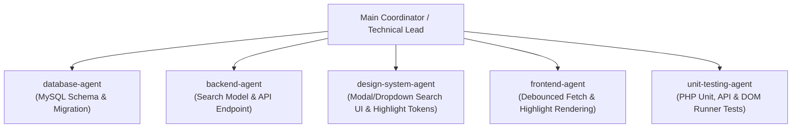

# Teamwork Implementation Plan: Native Full-Text Search & Live Instant Search

**ID Dokumen:** `plan_1.md`  
**Fitur:** Native Full-Text Search & Live Search (Debounced AJAX)  
**Terkait:** `docs/005_ide_pengembangan_v1.md` (Ide #1)  
**Prinsip Desain:** 100% Native (PHP 8.3+, MySQL FULLTEXT, Vanilla JS & CSS), Zero Dependencies.

---

## 1. Ringkasan & Sasaran Fitur
Menyediakan kemampuan pencarian artikel yang cepat dan akurat menggunakan indeks native MySQL `FULLTEXT` pada judul dan isi artikel, disertai antarmuka pencarian instan (live search modal/dropdown) dengan teknik *debouncing* di sisi klien serta penyorotan kata kunci (*keyword highlighting*).

---

## 2. Alokasi Peran & Tanggung Jawab Tim (Roster)



| Agen | Tanggung Jawab Spesifik |
|:---|:---|
| **`database-agent`** | Menambahkan indeks `FULLTEXT idx_posts_search (title, content)` pada tabel `posts` melalui script migrasi aman (`database/migrations/add_fulltext_search.sql`). |
| **`backend-agent`** | Mengembangkan query `MATCH(title, content) AGAINST(? IN NATURAL LANGUAGE MODE)` di `Post.php`, sanitasi kata kunci di `Sanitizer.php`, dan endpoint `GET /api/search?q={query}` di `PostController.php`. |
| **`design-system-agent`** | Merancang komponen antarmuka dialog modal/dropdown pencarian, efek keyboard shortcut (`Ctrl+K` / `Cmd+K`), badge tag hasil, dan warna token highlight pencarian di `variables.css`. |
| **`frontend-agent`** | Mengimplementasikan interaktivitas Vanilla JS di `public/assets/js/search.js`: handler shortcut, debouncer 250ms, AJAX fetch ke `/api/search`, navigasi panah keyboard (Arrow Up/Down), dan escape HTML aman sebelum inject DOM. |
| **`unit-testing-agent`** | Menulis unit test PHP di `tests/php/SearchTest.php` untuk validasi query/skor relevansi, penanganan karakter khusus/SQL injection, serta E2E flow test di test runner native. |

---

## 3. Rincian Teknis & Alur Implementasi

### Fase 1: Basis Data & Skema
1. Buat berkas migrasi SQL untuk menambah index:
   ```sql
   ALTER TABLE posts ADD FULLTEXT INDEX idx_posts_search (title, content);
   ```
2. Pastikan tabel bertipe engine InnoDB yang mendukung FULLTEXT di MySQL 8.0+.

### Fase 2: Backend & API Controller
1. Tambahkan method `Post::search(string $query, int $limit = 10): array` pada `src/Models/Post.php`.
2. Format respon JSON terstruktur:
   ```json
   {
     "success": true,
     "query": "arsitektur",
     "total": 3,
     "data": [
       {
         "id": 1,
         "title": "Arsitektur Multi-Agent",
         "slug": "arsitektur-multi-agent",
         "snippet": "...mengenal pondasi <b>arsitektur</b> modern...",
         "published_at": "2026-11-26"
       }
     ]
   }
   ```
3. Registrasikan route `GET /api/search` pada `src/Router.php`.

### Fase 3: Frontend & Desain Komponen
1. Tambahkan search bar/icon di navigation bar (`views/layouts/main.php`).
2. Sediakan modal pencarian instan dengan status: *idle*, *typing/loading*, *results*, dan *no-results*.
3. Implementasikan fungsi debounce murni di `public/assets/js/search.js` tanpa library lodash.

### Fase 4: Pengujian & Kualitas
1. Buat file `tests/php/SearchTest.php` yang memverifikasi:
   - Pencarian dengan kata kunci valid menghasilkan status 200 dan data artikel terkait.
   - Pencarian dengan kata kunci kosong atau spasi mengembalikan list kosong secara aman.
   - Proteksi injeksi karakter boolean/operator regex (`*`, `+`, `-`, quote marks).
2. Verifikasi bebas regresi dengan menjalankan: `php tests/php/runner.php`.

---

## 4. Acceptance Criteria (Kriteria Keberhasilan)
- [ ] Indeks `FULLTEXT` aktif di database tanpa mengganggu performa insert/update data posting.
- [ ] Endpoint `/api/search?q=...` merespons dalam waktu < 20ms dengan alokasi payload ringan.
- [ ] User dapat membuka pencarian dengan klik icon atau shortcut keyboard `Ctrl + K`.
- [ ] Hasil pencarian muncul secara asinkron tanpa reload halaman, dengan kata kunci yang dicari tersorot jelas.
- [ ] Seluruh unit test pencarian baru lulus 100% pada native runner.
