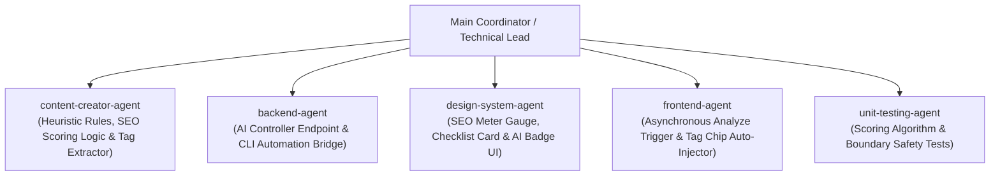

# Teamwork Implementation Plan: AI Workflow Orchestrator (SEO Scorer & Semantic Tagger)

**ID Dokumen:** `plan_10.md`  
**Fitur:** Antigravity AI Co-Pilot: In-CMS SEO Scorer & Semantic Tag Generator  
**Terkait:** `docs/005_ide_pengembangan_v1.md` (Ide #10)  
**Prinsip Desain:** Native Antigravity Multi-Agent Orchestration, Asynchronous Worker & Clean PHP Integration.

---

## 1. Ringkasan & Sasaran Fitur
Mengintegrasikan kecerdasan sistem multi-agent di Antigravity langsung ke dalam alur kerja editor manusia di Admin CMS NeoBlog, mencakup tool audit kualitas SEO real-time (pemeriksaan keterbacaan, kepadatan kata kunci, panjang judul & meta description) serta generator tag semantik otomatis berbasis analisis isi artikel sebelum diterbitkan.

---

## 2. Alokasi Peran & Tanggung Jawab Tim (Roster)



| Agen | Tanggung Jawab Spesifik |
|:---|:---|
| **`content-creator-agent`** | Merumuskan aturan heuristik analisis SEO & keterbacaan (*Flesch Reading Ease* adaptif, rasio heading, deteksi broken format, ekstraksi kata kunci berbobot TF-IDF native). |
| **`backend-agent`** | Membangun `src/Utils/SeoAnalyzer.php` native, controller `POST /admin/api/seo-analyze` (terproteksi CSRF & autentikasi admin), dan integrasi runner CLI di `scripts/agent-seo-review.php`. |
| **`design-system-agent`** | Mendesain widget "AI SEO Assistant" pada sidebar form edit artikel admin: skor lingkaran/gauge visual (0-100), checklist indikator warna (hijau/kuning/merah), dan daftar saran perbaikan. |
| **`frontend-agent`** | Membangun interaktivitas di `public/assets/js/admin-seo.js`: tombol *"Analyze with AI Co-Pilot"*, animasi loading interaktif, dan tombol 1-klik *"Apply Suggested Tags"* yang langsung memasukkan tag ke field form. |
| **`unit-testing-agent`** | Menulis pengujian pada `tests/php/SeoAnalyzerTest.php` untuk menguji konsistensi kalkulasi skor SEO pada artikel pendek vs panjang, keakuratan ekstraksi tag, dan ketahanan terhadap teks artikel berformat ekstrem. |

---

## 3. Rincian Teknis & Alur Implementasi

### Fase 1: Algoritma Evaluasi SEO Native (Server-Side)
1. Buat class analisis `src/Utils/SeoAnalyzer.php`:
   - **Evaluasi Judul:** Panjang optimal 40–60 karakter (skor maksimal 20).
   - **Evaluasi Meta Description:** Panjang optimal 120–160 karakter (skor maksimal 20).
   - **Kepadatan Konten:** Minimal 300 kata untuk artikel standar (skor maksimal 25).
   - **Struktur Heading:** Memeriksa keberadaan sub-judul `<h2>` atau `<h3>` (skor maksimal 15).
   - **Alt Text Gambar:** Memeriksa apakah semua gambar memiliki deskripsi alt (skor maksimal 10).
   - **Ekstraksi Tag Semantik:** Menyaring stopwords bahasa Indonesia & Inggris, menghitung frekuensi kata bermakna (skor maksimal 10).
2. Menghasilkan skor total akumulatif (0 s.d. 100) dan array rekomendasi actionable:
   ```json
   {
     "score": 85,
     "level": "Good",
     "suggestions": [
       "Judul terlalu pendek, tambahkan 5-10 karakter lagi.",
       "Semua gambar telah memiliki alt text yang baik."
     ],
     "suggested_tags": ["arsitektur", "php native", "antigravity"]
   }
   ```

### Fase 2: Endpoint API & Integrasi Admin CMS
1. Rute admin: `POST /admin/api/seo-analyze` (CSRF verified, hanya role `admin` & `editor`).
2. Sediakan juga perintah CLI: `php scripts/agent-seo-review.php --post-id=12` untuk dijalankan langsung oleh agen otonom di Antigravity.

### Fase 3: Antarmuka Sidebar Widget Admin
1. Pada form tambah/edit artikel (`views/admin/posts/edit.php`):
   - Tambahkan panel collapsible *"AI SEO Co-Pilot"*.
   - Lingkaran skor dinamis: Merah (<50), Kuning (50-79), Hijau (80-100).
   - Daftar rekomendasi tag dengan tombol *"Tambahkan Semua"*.

### Fase 4: Pengujian & Kualitas
1. Uji performa kalkulasi: Analisis artikel 5000 kata harus selesai dalam waktu < 50ms tanpa membebani server.
2. Uji batas: Menangani artikel kosong tanpa terjadi pembagian nol (*division by zero error*).
3. Jalankan suite testing: `php tests/php/runner.php`.

---

## 4. Acceptance Criteria (Kriteria Keberhasilan)
- [ ] Tombol *"Analyze with AI Co-Pilot"* berfungsi mulus di form artikel admin secara asinkron tanpa reload.
- [ ] Skor SEO dan rekomendasi perbaikan tampil secara jelas dan mudah dipahami penulis.
- [ ] Tag yang direkomendasikan AI dapat disematkan ke dalam artikel hanya dengan 1-klik.
- [ ] CLI script dapat dijalankan oleh sistem agent Antigravity untuk batch review artikel draf.
- [ ] Seluruh unit test algoritma SEO lulus 100% tanpa dependensi modul AI cloud eksternal.
