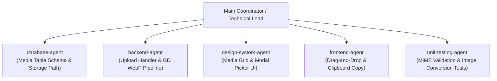

# Teamwork Implementation Plan: Native Media Manager & Image Optimizer

**ID Dokumen:** `plan_2.md`  
**Fitur:** Media Library & Image Optimizer Native (WebP Converter & Responsive Thumbnail)  
**Terkait:** `docs/005_ide_pengembangan_v1.md` (Ide #2)  
**Prinsip Desain:** 100% Native (PHP GD/exif, Vanilla CSS, Vanilla JS Fetch), Zero Dependencies.

---

## 1. Ringkasan & Sasaran Fitur
Menyediakan panel Media Library terintegrasi pada Admin Dashboard CMS untuk mengunggah, menata, dan mengoptimalkan gambar secara otomatis (konversi lossless/lossy ke WebP, pembuatan varian thumbnail responsif, dan pembersihan metadata sensitif EXIF) guna mempertahankan TTFB super cepat dan skor Google PageSpeed optimal.

---

## 2. Alokasi Peran & Tanggung Jawab Tim (Roster)



| Agen | Tanggung Jawab Spesifik |
|:---|:---|
| **`database-agent`** | Merancang skema tabel `media` (`id`, `filename`, `original_name`, `mime_type`, `file_size`, `dimensions`, `created_at`, `uploaded_by`) beserta foreign key ke `users`. |
| **`backend-agent`** | Membangun `src/Utils/ImageOptimizer.php` menggunakan ekstensi native PHP `gd` untuk resize dan `imagewebp()`, validasi MIME via `finfo_file()`, sanitasi nama file hash acak, dan controller `AdminMediaController.php`. |
| **`design-system-agent`** | Mendesain antarmuka Grid Media galeri di panel admin, indikator upload progress bar, kartu pratinjau gambar, dan modal picker gambar saat menulis artikel. |
| **`frontend-agent`** | Membangun interaktivitas drag-and-drop file upload di `public/assets/js/admin-media.js`, asynchronous multi-file upload progress via `fetch()`, serta fitur "Copy Markdown Image Link" ke clipboard dengan 1-klik. |
| **`unit-testing-agent`** | Menulis pengujian pada `tests/php/ImageOptimizerTest.php` untuk menguji penolakan berkas berbahaya (e.g. PHP terselubung dalam payload gambar), konversi WebP sukses, dan integritas ukuran thumbnail. |

---

## 3. Rincian Teknis & Alur Implementasi

### Fase 1: Basis Data & Direktori Penyimpanan
1. Migrasi tabel `media`:
   ```sql
   CREATE TABLE IF NOT EXISTS media (
       id INT AUTO_INCREMENT PRIMARY KEY,
       user_id INT NOT NULL,
       filename VARCHAR(255) NOT NULL,
       original_name VARCHAR(255) NOT NULL,
       mime_type VARCHAR(100) NOT NULL,
       file_size INT NOT NULL,
       width INT NULL,
       height INT NULL,
       created_at TIMESTAMP DEFAULT CURRENT_TIMESTAMP,
       FOREIGN KEY (user_id) REFERENCES users(id) ON DELETE CASCADE
   ) ENGINE=InnoDB DEFAULT CHARSET=utf8mb4;
   ```
2. Buat struktur folder aman: `public/uploads/{year}/{month}/` dan `public/uploads/thumbs/` dengan konfigurasi `.htaccess` / aturan server yang mencegah eksekusi skrip PHP di direktori uploads.

### Fase 2: Pipeline Pengolahan Gambar Native
1. Buat class `src/Utils/ImageOptimizer.php`:
   - Validasi Magic Bytes menggunakan `finfo(FILEINFO_MIME_TYPE)` (hanya terima image/jpeg, image/png, image/webp).
   - Buat fungsi `stripExif()` dan `convertToWebp($sourcePath, $destinationPath, $quality = 82)`.
   - Buat varian thumbnail (misal lebar 320px) untuk pratinjau cepat di dashboard.

### Fase 3: Antarmuka Admin & Media Picker
1. Halaman admin `/admin/media` yang memuat galeri berkas yang sudah diunggah.
2. Endpoint API:
   - `POST /admin/media/upload` (CSRF protected, multipart/form-data)
   - `DELETE /admin/media/delete` (CSRF protected)
3. Tombol sisipkan gambar langsung menyalin tag Markdown `` ke editor.

### Fase 4: Pengujian & Validasi
1. Uji upload gambar valid (JPEG, PNG) dan pastikan berkas target tersimpan sebagai `.webp`.
2. Uji upload berkas biner berbahaya (`shell.php` dengan ekstensi palsu `.jpg`) dan pastikan ditolak dengan pesan error HTTP 400.
3. Jalankan suite testing lengkap: `php tests/php/runner.php`.

---

## 4. Acceptance Criteria (Kriteria Keberhasilan)
- [ ] Pengguna role `admin` & `editor` dapat mengunggah gambar via drag-and-drop maupun file browser.
- [ ] Seluruh gambar otomatis dikonversi ke format WebP terkompresi dengan penghematan ukuran berkas > 30% tanpa distorsi visual signifikan.
- [ ] Metadata EXIF (lokasi GPS kamera, perangkat) terhapus secara otomatis demi privasi pengguna.
- [ ] Berkas non-gambar dan berkas berbahaya ditolak secara tegas di level server.
- [ ] Pengujian native unit test untuk optimizer lulus tanpa dependensi modul composer eksternal.
