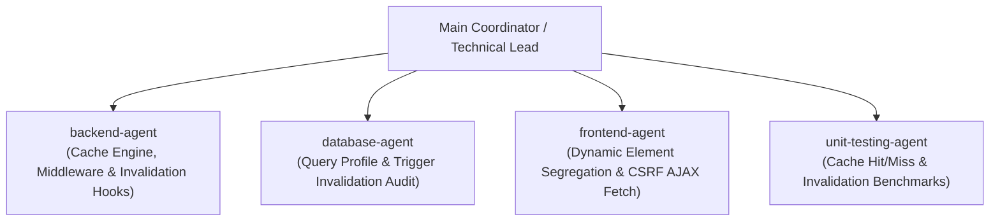

# Teamwork Implementation Plan: File-Based Static Cache Layer

**ID Dokumen:** `plan_3.md`  
**Fitur:** Zero-Overhead File-Based Static Caching & Intelligent Invalidation  
**Terkait:** `docs/005_ide_pengembangan_v1.md` (Ide #3)  
**Prinsip Desain:** 100% Native PHP Output Buffering & Filesystem Cache, Zero Dependencies.

---

## 1. Ringkasan & Sasaran Fitur
Membangun sistem caching statis berbasis berkas HTML di sisi server untuk halaman publik (beranda artikel dan halaman detail artikel). Sistem memotong pemrosesan query database dan eksekusi controller untuk request umum, menurunkan waktu respon server (TTFB) hingga < 5ms, dengan mekanisme pembersihan cache pintar (*invalidation*) saat terjadi perubahan data.

---

## 2. Alokasi Peran & Tanggung Jawab Tim (Roster)

| Agen | Tanggung Jawab Spesifik |
|:---|:---|
| **`backend-agent`** | Membangun class `src/Utils/Cache.php` (metode `get()`, `set()`, `invalidateTag()`, `clear()`), integrasi output buffering (`ob_start()`, `ob_get_contents()`) pada `Router.php` / Front Controller. |
| **`database-agent`** | Meninjau query yang paling sering dieksekusi pada `Post.php` dan `Comment.php` guna menyusun strategi cache key berbasis hash URL dan status publikasi. |
| **`frontend-agent`** | Memisahkan elemen dinamis pengguna (seperti CSRF token untuk form komentar dan preferensi theme) agar halaman HTML statis tetap dapat digunakan oleh semua pengunjung tanpa kebocoran sesi. |
| **`test-agent`** | Membuat skenario uji pada `tests/php/CacheTest.php`: verifikasi cache hit, verifikasi cache miss, serta verifikasi pembersihan otomatis cache artikel ketika admin menyunting postingan atau komentar baru disetujui. |

---

## 3. Rincian Teknis & Alur Implementasi

### Fase 1: Desain Cache Manager Native
1. Buat direktori penyimpanan: `storage/cache/pages/`.
2. Struktur berkas cache:
   - Nama file: `sha1($url) . '.html'`
   - Metadata header: waktu kadaluwarsa (TTL, misal 3600 detik) atau header komentar HTML penanda (`<!-- Cached at 2026-11-28 18:00:00 -->`).
3. Class `src/Utils/Cache.php`:
   - `serveIfCached(string $key): bool`
   - `saveCache(string $key, string $htmlContent): void`
   - `invalidatePost(string $slug): void`
   - `flushAll(): void`

### Fase 2: Aturan Bypass & Pemisahan State Sesi
1. Request yang **TIDAK** boleh di-cache:
   - Semua rute admin (`/admin/*`) dan rute autentikasi (`/auth/*`).
   - Request HTTP `POST`, `PUT`, `DELETE`.
   - Request dari pengguna yang memiliki sesi aktif login admin.
2. Penanganan CSRF Token pada form komentar:
   - Ambil CSRF token secara asinkron via endpoint ringan `GET /api/csrf-token` saat form komentar pertama kali difokuskan, atau gunakan header token AJAX.

### Fase 3: Hook Invalidation (Pembersihan Otomatis)
1. Hook pembersihan dipasang pada:
   - `AdminPostController::store()` / `update()` / `delete()` -> bersihkan cache beranda & cache halaman artikel terkait.
   - `CommentController::store()` / `AdminCommentController::approve()` -> bersihkan cache halaman artikel yang bersangkutan.
2. Sediakan tombol admin: *"Purge Entire Cache"* di Dashboard CMS.

### Fase 4: Pengujian & Tolok Ukur Kinerja
1. Uji hit rate: Request pertama menghasilkan `X-NeoBlog-Cache: MISS`, request kedua menghasilkan `X-NeoBlog-Cache: HIT`.
2. Uji invalidasi: Edit judul artikel di admin -> request berikutnya wajib menghasilkan konten baru (`MISS` lalu refresh `HIT`).
3. Verifikasi integritas: Jalankan `php tests/php/runner.php`.

---

## 4. Acceptance Criteria (Kriteria Keberhasilan)
- [ ] Pengunjung publik mendapatkan respon HTML cache dengan TTFB < 5ms pada request berulang.
- [ ] Tidak ada kebocoran sesi admin atau data pribadi pada konten cache.
- [ ] Cache terhapus secara otomatis begitu artikel diperbarui atau komentar disetujui.
- [ ] Admin memiliki kontrol manual untuk membersihkan seluruh berkas cache melalui Dashboard CMS.
- [ ] Seluruh unit test cache lulus 100% tanpa library ekstensi eksternal.
