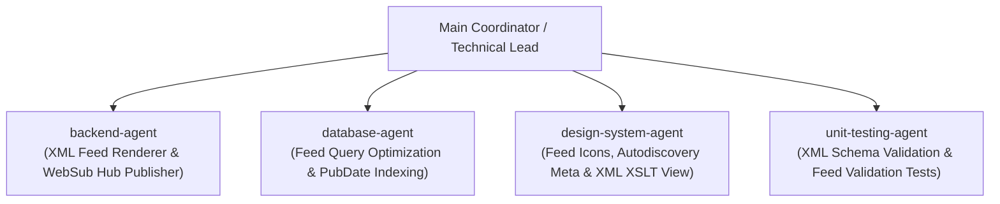

# Teamwork Implementation Plan: RSS, Atom Feed & WebSub Syndication

**ID Dokumen:** `plan_4.md`  
**Fitur:** Standard RSS 2.0, Atom 1.0 Feeds & WebSub Real-Time Notification  
**Terkait:** `docs/005_ide_pengembangan_v1.md` (Ide #4)  
**Prinsip Desain:** 100% Native PHP XML Generation, Zero Dependencies.

---

## 1. Ringkasan & Sasaran Fitur
Menyediakan sindikasi konten otomatis berstandar terbuka (RSS 2.0 dan Atom 1.0) untuk memudahkan pembaca berlangganan melalui aplikasi feed reader (Feedly, NetNewsWire) serta agregator berita komunitas developer, dilengkapi dengan notifikasi publikasi instan berbasis protokol WebSub (PubSubHubbub).

---

## 2. Alokasi Peran & Tanggung Jawab Tim (Roster)



| Agen | Tanggung Jawab Spesifik |
|:---|:---|
| **`backend-agent`** | Membangun `src/Controllers/FeedController.php` dengan output XML valid (`XMLWriter` atau template murni), escape entitas XML aman, header `Content-Type: application/xml`, dan fungsi notifikasi WebSub Hub. |
| **`database-agent`** | Memastikan query pengambilan 20 artikel terbaru (`Post::getRecentPublished(20)`) teroptimasi dengan index `idx_published_at`. |
| **`design-system-agent`** | Menambahkan tag autodiscovery feed pada `<head>` layout utama (`<link rel="alternate" type="application/rss+xml" ...>`), stylesheet XSLT sederhana agar berkas feed ramah dibaca manusia ketika dibuka di browser, serta ikon RSS di footer. |
| **`unit-testing-agent`** | Mengembangkan unit test `tests/php/FeedTest.php` untuk memvalidasi kepatuhan format XML (tidak ada sintaks unescaped `&`, `<`, `>`), kelengkapan field wajib (`title`, `link`, `guid`, `pubDate`), dan status HTTP respon. |

---

## 3. Rincian Teknis & Alur Implementasi

### Fase 1: Spesifikasi Rute & Format Feed
1. Rute yang dibuka pada `src/Router.php`:
   - `GET /feed` dan `GET /rss.xml` -> RSS 2.0.
   - `GET /atom.xml` -> Atom 1.0.
   - `GET /category/{slug}/feed` -> Feed spesifik per kategori.
2. Struktur elemen RSS 2.0 wajib:
   - `<channel>`: `title`, `link`, `description`, `language`, `lastBuildDate`, `atom:link`.
   - `<item>`: `title`, `link`, `guid` (isPermaLink="true"), `pubDate` (RFC 822 / RFC 2822 format), `description` (excerpt aman), `content:encoded` (opsional full content dalam CDATA).

### Fase 2: Implementasi Controller Feed Native
1. Di `src/Controllers/FeedController.php`:
   - Mengambil postingan berstatus `published` dari database.
   - Menggunakan `DateTime::format(DateTime::RFC822)` untuk tanggal rilis.
   - Mengatur header HTTP:
     ```php
     header('Content-Type: application/rss+xml; charset=utf-8');
     ```
2. Pembuatan stylesheet `public/assets/xml/feed.xsl` agar pengunjung yang membuka feed langsung di browser melihat tampilan bergaya web yang rapi.

### Fase 3: Integrasi WebSub Hub Publisher (Opsional/Configurable)
1. Buat helper `src/Utils/WebSub.php`:
   - Mengirim request `POST` form data ke public hub (seperti `https://pubsubhubbub.appspot.com/`) saat posting baru diterbitkan:
     - `hub.mode=publish`
     - `hub.url=https://domain.com/feed`
   - Berjalan non-blocking atau aman terhadap kegagalan jaringan luar.

### Fase 4: Pengujian & Validasi
1. Tulis kasus uji di `tests/php/FeedTest.php`:
   - Parse output string feed menggunakan `simplexml_load_string()`.
   - Validasi bahwa XML dapat di-parse tanpa warning syntax error.
   - Verifikasi bahwa posting draf **TIDAK** pernah masuk ke dalam feed publik.
2. Jalankan test runner: `php tests/php/runner.php`.

---

## 4. Acceptance Criteria (Kriteria Keberhasilan)
- [ ] Endpoint `/feed` dan `/rss.xml` menghasilkan payload XML RSS 2.0 valid yang dapat dibaca sempurna oleh validator standar W3C Feed.
- [ ] Endpoint `/atom.xml` mematuhi spesifikasi Atom 1.0.
- [ ] Seluruh tag autodiscovery terpasang rapi di bagian `<head>` seluruh halaman publik.
- [ ] Draf dan posting non-aktif terlindungi secara ketat dari paparan feed.
- [ ] Pengujian native validasi XML lulus 100%.
