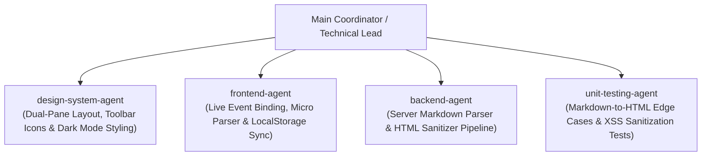

# Teamwork Implementation Plan: Native Split-Screen Markdown Editor

**ID Dokumen:** `plan_5.md`  
**Fitur:** Native Split-Screen Markdown Editor, Live Preview & Local Auto-Save  
**Terkait:** `docs/005_ide_pengembangan_v1.md` (Ide #5)  
**Prinsip Desain:** 100% Vanilla JS & CSS, Native Micro Markdown Parser, Zero External Vendor.

---

## 1. Ringkasan & Sasaran Fitur
Menyediakan pengalaman menulis artikel teknis yang modern dan nyaman bagi penulis di Dashboard CMS melalui antarmuka editor dua panel (kiri: input Markdown dengan syntax toolbar cepat, kanan: pratinjau live HTML), sinkronisasi scroll cerdas, serta penyimpanan draf otomatis (*auto-save*) di `localStorage` peramban untuk mencegah kehilangan data.

---

## 2. Alokasi Peran & Tanggung Jawab Tim (Roster)

| Agen | Tanggung Jawab Spesifik |
|:---|:---|
| **`design-system-agent`** | Mendesain antarmuka split layout (`.editor-container`, `.editor-pane`, `.preview-pane`), toolbar tombol formatting (Bold, Italic, Code, Heading, Link, Quote), scrollbar sinkron, dan mode layar penuh (*Zen Mode / Fullscreen*). |
| **`frontend-agent`** | Membangun script `public/assets/js/markdown-editor.js`: micro-parser regex Markdown client-side untuk pratinjau instan (<10ms), auto-save berkala ke `localStorage`, keyboard shortcut (`Ctrl+B`, `Ctrl+I`, `Tab` indenting), dan sinkronisasi scroll proporsional. |
| **`backend-agent`** | Menyempurnakan class `src/Utils/MarkdownParser.php` di sisi server untuk konversi final saat draf disimpan ke database, serta integrasi pembersihan mendalam via `Sanitizer::cleanHtml()` guna mencegah serangan Stored XSS. |
| **`unit-testing-agent`** | Menulis unit test di `tests/php/MarkdownParserTest.php` dan `tests/js/editor-test.js` untuk menguji konversi format tabel, list bersarang, blok kode dengan tag bahasa, dan netralisasi payload XSS berbahaya (e.g. `<script>`, `onload=`, `javascript:` URI). |

---

## 3. Rincian Teknis & Alur Implementasi

### Fase 1: Layout CSS & Komponen Dual-Pane
1. Di `public/assets/css/admin.css`:
   - Atur grid 2-kolom responsif: `grid-template-columns: 1fr 1fr;` pada viewport desktop, serta tab toggle (Edit vs Preview) pada layar ponsel/tablet.
   - Styling blok kode dan elemen tipografi preview agar identik dengan tampilan akhir artikel publik.

### Fase 2: Native Micro Markdown Parser (Client & Server)
1. Client-Side (Vanilla JS untuk preview langsung):
   - Parser cepat berbasis RegEx mengganti:
     - Header (`#` s.d. `######`)
     - Formatting teks (`**tebal**`, `*miring*`, `~~coret~~`)
     - Code block (\`\`\`lang ... \`\`\`) dan inline code (\`code\`)
     - Blockquote (`> text`)
     - Lists (`- item`, `1. item`)
     - Link (`[teks](url)`) dan Gambar (``)
2. Server-Side (`src/Utils/MarkdownParser.php`):
   - Melakukan parsing yang kuat dan aman saat form di-submit, dilanjutkan dengan sanitasi HTML whitelist ketat.

### Fase 3: Auto-Save & Fitur Ketik Cerdas
1. Simpan draf ke `localStorage.setItem('draft_' + postId, text)` setiap 3 detik setelah aktivitas ketik berhenti.
2. Ketika membuka halaman edit artikel, periksa apakah ada draf lokal yang lebih baru daripada database; tampilkan notifikasi pemulihan jika tersedia: *"Draf lokal yang belum tersimpan ditemukan. Pulihkan?"*.
3. Dukungan tombol `Tab` pada textarea untuk menyisipkan 2 spasi alih-alih berpindah fokus elemen.

### Fase 4: Pengujian & Kualitas
1. Uji parsing tag kode ganda dan karakter spesial (`<`, `>`, `&`).
2. Uji injeksi XSS: Input `[klik](javascript:alert(1))` harus dinetralkan menjadi link aman atau ditolak.
3. Jalankan test runner: `php tests/php/runner.php` dan `node tests/js/runner.js`.

---

## 4. Acceptance Criteria (Kriteria Keberhasilan)
- [ ] Editor split-screen responsif dan nyaman digunakan di desktop maupun perangkat mobile.
- [ ] Perubahan pada panel input langsung tercermin pada panel pratinjau dalam waktu < 20ms tanpa lag.
- [ ] Draf tersimpan otomatis di penyimpanan lokal browser dan dapat dipulihkan jika tab/peramban tertutup tanpa sengaja.
- [ ] Bebas dari celah XSS pada semua elemen Markdown yang didukung.
- [ ] Seluruh unit test parser lulus 100% tanpa bantuan library eksternal (seperti Marked atau Parsedown).
