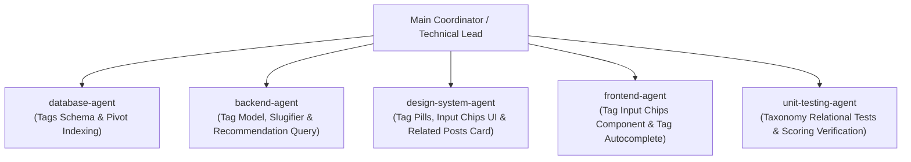

# Teamwork Implementation Plan: Multi-Tagging Taxonomy & Related Posts

**ID Dokumen:** `plan_6.md`  
**Fitur:** Multi-Tagging System & Related Posts Recommendation Engine  
**Terkait:** `docs/005_ide_pengembangan_v1.md` (Ide #6)  
**Prinsip Desain:** 100% Native SQL (Many-to-Many Relational 3NF), Zero Dependencies.

---

## 1. Ringkasan & Sasaran Fitur
Memperluas sistem taksonomi NeoBlog yang sebelumnya hanya mendukung kategori tunggal menjadi multi-tagging (banyak tag per artikel), dilengkapi dengan algoritma rekomendasi native SQL yang menampilkan daftar "Artikel Terkait" (*Related Posts*) di bawah artikel untuk meningkatkan keterikatan (*dwell time*) pembaca.

---

## 2. Alokasi Peran & Tanggung Jawab Tim (Roster)



| Agen | Tanggung Jawab Spesifik |
|:---|:---|
| **`database-agent`** | Merancang tabel `tags` (`id`, `name`, `slug`, `created_at`) dan pivot table `post_tags` (`post_id`, `tag_id`, composite primary key) dengan indeks performa tinggi. |
| **`backend-agent`** | Membangun class `src/Models/Tag.php`, metode `Post::syncTags(int $postId, array $tags)`, dan query skoring artikel terkait di `Post::getRelatedPosts(int $postId, int $limit = 3)` berdasarkan irisan tag dan kategori bersama. |
| **`design-system-agent`** | Mendesain token visual badge/pill tag, grid kartu artikel terkait di bawah konten utama (`detail.php`), serta antarmuka tag chips yang interaktif di panel admin. |
| **`frontend-agent`** | Mengembangkan interaktivitas input tag di form admin (`public/assets/js/tag-input.js`): menambah tag dengan tombol `Enter` atau koma, menghapus tag dengan tombol `Backspace`, serta filter tag di daftar artikel publik. |
| **`unit-testing-agent`** | Menulis pengujian pada `tests/php/TagTest.php` untuk memvalidasi pembuatan slug tag unik, sinkronisasi relasi postingan, penanganan tag duplikat, dan akurasi daftar rekomendasi artikel terkait. |

---

## 3. Rincian Teknis & Alur Implementasi

### Fase 1: Migrasi Skema Basis Data
1. Buat tabel taksonomi di database:
   ```sql
   CREATE TABLE IF NOT EXISTS tags (
       id INT AUTO_INCREMENT PRIMARY KEY,
       name VARCHAR(50) NOT NULL UNIQUE,
       slug VARCHAR(60) NOT NULL UNIQUE,
       created_at TIMESTAMP DEFAULT CURRENT_TIMESTAMP
   ) ENGINE=InnoDB DEFAULT CHARSET=utf8mb4;

   CREATE TABLE IF NOT EXISTS post_tags (
       post_id INT NOT NULL,
       tag_id INT NOT NULL,
       PRIMARY KEY (post_id, tag_id),
       FOREIGN KEY (post_id) REFERENCES posts(id) ON DELETE CASCADE,
       FOREIGN KEY (tag_id) REFERENCES tags(id) ON DELETE CASCADE
   ) ENGINE=InnoDB DEFAULT CHARSET=utf8mb4;
   ```

### Fase 2: Logika Backend & Query Rekomendasi
1. Model `src/Models/Tag.php`:
   - `findOrCreate(string $name): int`
   - `getByPostId(int $postId): array`
2. Algoritma rekomendasi native SQL di `Post.php`:
   ```sql
   SELECT p.*, COUNT(pt.tag_id) as common_tags
   FROM posts p
   JOIN post_tags pt ON p.id = pt.post_id
   WHERE pt.tag_id IN (SELECT tag_id FROM post_tags WHERE post_id = :current_post_id)
     AND p.id != :current_post_id
     AND p.status = 'published'
   GROUP BY p.id
   ORDER BY common_tags DESC, p.published_at DESC
   LIMIT :limit;
   ```
   *Fallback:* Jika tidak ada irisan tag, ambil artikel terbaru dari `category_id` yang sama.

### Fase 3: Antarmuka Publik & Halaman Arsip Tag
1. Rute publik: `GET /tag/{slug}` untuk melihat seluruh artikel yang memiliki tag terkait.
2. Tampilkan badge tag di bawah judul artikel dan kartu artikel beranda.
3. Tampilkan blok "Artikel Terkait" di akhir halaman artikel `views/posts/detail.php`.

### Fase 4: Pengujian & Validasi
1. Uji relasi cascade: Jika sebuah artikel dihapus, seluruh entri di `post_tags` harus otomatis terhapus tanpa menyisakan relasi yatim (*orphan records*).
2. Uji efisiensi query: Pastikan tidak terjadi masalah query N+1 saat memuat tag untuk daftar artikel di beranda.
3. Jalankan suite testing: `php tests/php/runner.php`.

---

## 4. Acceptance Criteria (Kriteria Keberhasilan)
- [ ] Penulis dapat menyematkan beberapa tag pada artikel melalui antarmuka admin yang responsif.
- [ ] Halaman artikel publik menampilkan tag terkait yang dapat diklik menuju arsip `/tag/{slug}`.
- [ ] Blok "Artikel Terkait" menampilkan artikel relevan berdasarkan kesamaan tag dan kategori.
- [ ] Integritas referensial basis data terjaga aman dengan foreign key `ON DELETE CASCADE`.
- [ ] Seluruh unit test model tag dan rekomendasi lulus 100%.
