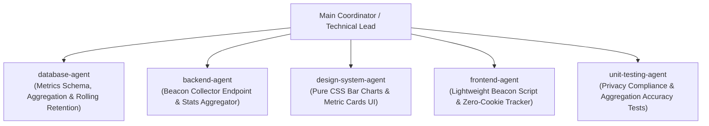

# Teamwork Implementation Plan: Privacy-Focused Native Analytics Dashboard

**ID Dokumen:** `plan_7.md`  
**Fitur:** Privacy-First Zero-Cookie Native Analytics & Metrics Dashboard  
**Terkait:** `docs/005_ide_pengembangan_v1.md` (Ide #7)  
**Prinsip Desain:** 100% Native (Tanpa Cookie, Tanpa Pelacak Pihak Ketiga, Patuh GDPR/UU PDP), Zero Dependencies.

---

## 1. Ringkasan & Sasaran Fitur
Menyediakan modul analitik pengunjung internal yang ringan, transparan, dan berorientasi privasi penuh tanpa menggunakan cookie pihak ketiga (seperti Google Analytics), tidak melacak data identitas pribadi (PII), menggunakan metode non-blocking `navigator.sendBeacon()`, serta menyajikan visualisasi data metrik di Dashboard CMS.

---

## 2. Alokasi Peran & Tanggung Jawab Tim (Roster)



| Agen | Tanggung Jawab Spesifik |
|:---|:---|
| **`database-agent`** | Merancang skema tabel analitik `page_views` (`id`, `post_id`, `url_path`, `referrer_domain`, `device_type`, `view_date`, `created_at`) dengan partisi/index berbasis tanggal, serta prosedur pembersihan data historis (*data retention policy*). |
| **`backend-agent`** | Membangun endpoint pengumpul `POST /api/collect` yang cepat dan non-blocking, anonimisasi data (hashing IP satu arah bersalt harian untuk deduplikasi unique visitor tanpa menyimpan IP asli), dan agregator statistik di `src/Models/Analytics.php`. |
| **`design-system-agent`** | Merancang visualisasi grafik batang dan kartu metrik (*Total Views*, *Top Articles*, *Referrer Channels*, *Device Share*) murni menggunakan Flexbox/Grid CSS Native tanpa pustaka Chart.js. |
| **`frontend-agent`** | Mengembangkan skrip pelacak 1KB `public/assets/js/tracker.js` yang mengirim metrik via `navigator.sendBeacon()` saat halaman dimuat, menghormati sinyal `Do Not Track` (`navigator.doNotTrack`), dan mengabaikan kunjungan admin. |
| **`unit-testing-agent`** | Menulis unit test di `tests/php/AnalyticsTest.php` untuk memvalidasi keamanan endpoint kolektor, kepatuhan zero-PII (tidak ada IP atau User-Agent lengkap yang tersimpan), dan akurasi kalkulasi metrik agregat. |

---

## 3. Rincian Teknis & Alur Implementasi

### Fase 1: Skema Basis Data & Kebijakan Privasi
1. Migrasi tabel analitik:
   ```sql
   CREATE TABLE IF NOT EXISTS analytics_views (
       id BIGINT AUTO_INCREMENT PRIMARY KEY,
       post_id INT NULL,
       path VARCHAR(255) NOT NULL,
       referrer VARCHAR(255) NULL,
       device_type ENUM('desktop', 'mobile', 'tablet', 'bot') DEFAULT 'desktop',
       visitor_hash CHAR(64) NOT NULL,
       view_date DATE NOT NULL,
       created_at TIMESTAMP DEFAULT CURRENT_TIMESTAMP,
       INDEX idx_analytics_date (view_date),
       INDEX idx_analytics_post (post_id)
   ) ENGINE=InnoDB DEFAULT CHARSET=utf8mb4;
   ```
2. Mekanisme deduplikasi privasi:
   `visitor_hash = hash('sha256', $todayDate . $salt . $_SERVER['REMOTE_ADDR'] . $_SERVER['HTTP_USER_AGENT'])` (Salt di-generate ulang setiap hari sehingga data lintas hari tidak dapat dilacak kembali ke individu).

### Fase 2: Endpoint Kolektor Non-Blocking
1. Endpoint `POST /api/collect`:
   - Validasi payload JSON: `{ path, referrer, post_id, screen_width }`.
   - Abaikan jika request menyertakan cookie sesi admin yang sedang aktif atau header `DNT: 1`.
   - Mengembalikan respon instan HTTP 204 No Content.

### Fase 3: Dashboard Visualisasi Admin Native
1. Halaman admin `/admin/analytics`:
   - Metrik 7 Hari / 30 Hari Terakhir.
   - Grafik batang CSS Native (`height: calc(var(--val) * 1%)`) responsif.
   - Tabel 10 Artikel Teratas (*Top Performing Posts*).
   - Daftar Sumber Rujukan Teratas (*Top Referrers*).

### Fase 4: Pengujian & Kepatuhan
1. Uji pemuatan skrip: Skrip pelacak tidak boleh mengganggu metrik Core Web Vitals (LCP, CLS, FID).
2. Verifikasi audit privasi: Konfirmasi bahwa tidak ada cookie analitik yang disimpan di browser pembaca.
3. Jalankan test runner: `php tests/php/runner.php`.

---

## 4. Acceptance Criteria (Kriteria Keberhasilan)
- [ ] Pengumpulan data analitik berlangsung secara asinkron tanpa membebani rendering halaman publik.
- [ ] 100% patuh privasi: Tanpa cookie, tidak ada data pribadi (PII) yang disimpan, dan menghormati sinyal `Do Not Track`.
- [ ] Kunjungan admin otomatis diabaikan agar data metrik tidak bias.
- [ ] Dashboard CMS menampilkan ringkasan performa artikel dengan visualisasi CSS native yang elegan.
- [ ] Seluruh unit test modul analitik lulus 100%.
