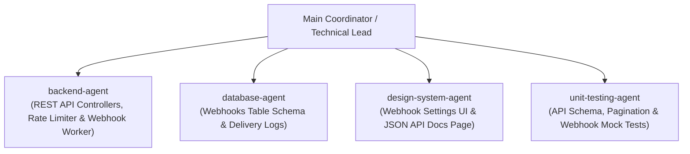

# Teamwork Implementation Plan: Public REST API & Webhook Dispatcher

**ID Dokumen:** `plan_8.md`  
**Fitur:** Headless Public RESTful API & Outgoing Webhook Event Dispatcher  
**Terkait:** `docs/005_ide_pengembangan_v1.md` (Ide #8)  
**Prinsip Desain:** 100% Native PHP API Controller & cURL Dispatcher, Zero External SDKs.

---

## 1. Ringkasan & Sasaran Fitur
Membuka antarmuka data publik standar industri berbasis RESTful JSON API sehingga NeoBlog dapat difungsikan sebagai *Headless CMS* bagi aplikasi frontend modern atau mobile apps, serta menyediakan mekanisme *Outgoing Webhooks* untuk memicu notifikasi instan ke channel komunitas (seperti Discord, Telegram, atau Slack) saat ada artikel baru yang dipublikasikan.

---

## 2. Alokasi Peran & Tanggung Jawab Tim (Roster)



| Agen | Tanggung Jawab Spesifik |
|:---|:---|
| **`database-agent`** | Merancang skema tabel `webhooks` (`id`, `name`, `payload_url`, `secret_token`, `events`, `is_active`, `created_at`) dan tabel riwayat pengiriman `webhook_logs` (`id`, `webhook_id`, `status_code`, `response_time_ms`, `error_message`, `delivered_at`). |
| **`backend-agent`** | Membangun controller API publik `src/Controllers/Api/PostApiController.php` dengan pagination dan filter kategori, micro rate limiter berbasis token bucket native, serta dispatcher webhook `src/Utils/WebhookDispatcher.php` menggunakan native PHP `curl_multi` / `curl_exec`. |
| **`design-system-agent`** | Mendesain halaman manajemen Webhook di Admin CMS (form tambah endpoint, generator secret key, tabel log pengiriman) serta halaman dokumentasi interaktif sederhana untuk REST API. |
| **`unit-testing-agent`** | Menulis unit test pada `tests/php/ApiTest.php` untuk memverifikasi konsistensi struktur respon JSON, kode status HTTP standar (200, 404, 429), keamanan signature HMAC SHA256 pada header webhook (`X-NeoBlog-Signature`), dan penanganan kegagalan koneksi URL target. |

---

## 3. Rincian Teknis & Alur Implementasi

### Fase 1: Standar Endpoint REST API Publik
1. Rute API versi 1 pada `src/Router.php`:
   - `GET /api/v1/posts` : Mengambil daftar posting publik (parameter: `page`, `limit`, `category`, `tag`, `search`).
   - `GET /api/v1/posts/{slug}` : Mengambil detail posting lengkap beserta komentar yang disetujui.
   - `GET /api/v1/categories` : Daftar seluruh kategori dan jumlah artikel.
2. Format standar respon API:
   ```json
   {
     "status": "success",
     "data": [...],
     "pagination": {
       "current_page": 1,
       "total_pages": 5,
       "total_items": 48,
       "has_next": true
     }
   }
   ```
3. Header HTTP: `Content-Type: application/json; charset=utf-8` dan `Access-Control-Allow-Origin: *`.

### Fase 2: Skema Basis Data & Manajemen Webhook
1. Migrasi tabel webhook:
   ```sql
   CREATE TABLE IF NOT EXISTS webhooks (
       id INT AUTO_INCREMENT PRIMARY KEY,
       name VARCHAR(100) NOT NULL,
       url VARCHAR(255) NOT NULL,
       secret VARCHAR(64) NOT NULL,
       event VARCHAR(50) NOT NULL DEFAULT 'post.published',
       is_active TINYINT(1) DEFAULT 1,
       created_at TIMESTAMP DEFAULT CURRENT_TIMESTAMP
   ) ENGINE=InnoDB DEFAULT CHARSET=utf8mb4;
   ```
2. Event yang didukung:
   - `post.published` : Saat draf berubah status menjadi dipublikasikan.
   - `comment.created` : Saat komentar baru masuk menunggu moderasi.

### Fase 3: Mekanisme Pengiriman Aman (Webhook Dispatcher)
1. Di `src/Utils/WebhookDispatcher.php`:
   - Siapkan payload JSON event.
   - Buat signature keamanan:
     ```php
     $signature = hash_hmac('sha256', $jsonPayload, $webhook['secret']);
     ```
   - Kirim via cURL dengan timeout pendek (maksimal 3 detik) agar tidak menghambat respon admin UI.
   - Catat status respon HTTP (e.g. 200, 500, timeout) ke `webhook_logs`.

### Fase 4: Pengujian & Validasi
1. Uji endpoint API: Pastikan draf artikel tidak pernah dapat diakses via API publik.
2. Uji rate limit: Pastikan request berlebihan menerima respon HTTP `429 Too Many Requests`.
3. Jalankan suite testing: `php tests/php/runner.php`.

---

## 4. Acceptance Criteria (Kriteria Keberhasilan)
- [ ] Endpoint `/api/v1/posts` menyajikan data terstruktur yang mudah dikonsumsi frontend eksternal.
- [ ] Webhook terpicu otomatis saat artikel baru dipublikasikan dan mengirim payload aman dengan signature HMAC.
- [ ] Kegagalan webhook di sisi penerima tidak menggagalkan proses penyimpanan artikel di admin.
- [ ] Log status pengiriman webhook tercatat rapi di panel admin untuk kemudahan audit.
- [ ] Seluruh unit test REST API dan Webhook Dispatcher lulus 100%.
