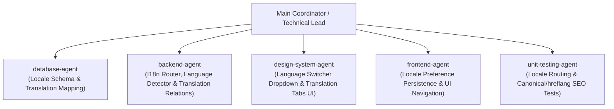

# Teamwork Implementation Plan: Multi-Language Content (i18n & Localization)

**ID Dokumen:** `plan_9.md`  
**Fitur:** Multi-Language Content Architecture & hreflang SEO Localization  
**Terkait:** `docs/005_ide_pengembangan_v1.md` (Ide #9)  
**Prinsip Desain:** 100% Native Schema Translation Pattern, Zero Translation Libraries.

---

## 1. Ringkasan & Sasaran Fitur
Memperkenalkan arsitektur konten multibahasa (misalnya: Bahasa Indonesia sebagai bahasa utama dan Bahasa Inggris sebagai bahasa global) untuk memperluas jangkauan pembaca, mencakup pemetaan relasi antar artikel terjemahan, pemilih bahasa (*language switcher*), antarmuka penulisan terjemahan di admin, serta optimasi tag SEO `hreflang` otomatis.

---

## 2. Alokasi Peran & Tanggung Jawab Tim (Roster)



| Agen | Tanggung Jawab Spesifik |
|:---|:---|
| **`database-agent`** | Menambahkan kolom `locale VARCHAR(10) DEFAULT 'id'` dan relasi `translation_of_id INT NULL` (self-referencing foreign key ke `posts.id`) pada tabel `posts`, serta indeks komposit performa `(locale, slug)`. |
| **`backend-agent`** | Menyesuaikan router URL untuk mendukung awalan bahasa opsional (e.g. `/en/posts/my-slug`), deteksi bahasa peramban (`Accept-Language`), serta helper pembuatan tag HTML SEO `<link rel="alternate" hreflang="...">`. |
| **`design-system-agent`** | Mendesain komponen *Language Switcher* di navbar publik, lencana penanda bahasa pada kartu artikel, dan antarmuka "Kelola Terjemahan" (tombol *Add English Translation*) di form admin artikel. |
| **`frontend-agent`** | Membangun interaktivitas switcher bahasa di `public/assets/js/i18n.js` yang menyimpan preferensi pengunjung di cookie atau `localStorage`, serta navigasi langsung ke versi terjemahan artikel yang bersangkutan jika tersedia. |
| **`unit-testing-agent`** | Menulis pengujian pada `tests/php/I18nTest.php` untuk memvalidasi pemisahan artikel per bahasa, konsistensi relasi terjemahan dua arah, dan kelengkapan tag SEO `hreflang` untuk mesin pencari. |

---

## 3. Rincian Teknis & Alur Implementasi

### Fase 1: Perubahan Skema Basis Data
1. Modifikasi tabel `posts`:
   ```sql
   ALTER TABLE posts 
   ADD COLUMN locale VARCHAR(10) NOT NULL DEFAULT 'id' AFTER status,
   ADD COLUMN translation_of_id INT NULL AFTER locale,
   ADD CONSTRAINT fk_posts_translation 
       FOREIGN KEY (translation_of_id) REFERENCES posts(id) ON DELETE SET NULL;

   CREATE INDEX idx_posts_locale_status ON posts(locale, status);
   ```

### Fase 2: Penyesuaian Router & Controller
1. Resolusi rute fleksibel:
   - Request `GET /` atau `GET /posts` -> Menyajikan konten bahasa default (`id`).
   - Request `GET /en/` atau `GET /en/posts` -> Menyajikan konten bahasa Inggris (`en`).
   - Request `GET /posts/{slug}` dan `GET /en/posts/{slug}` -> Menemukan artikel berdasarkan kombinasi `slug` dan `locale`.
2. Model method di `Post.php`:
   - `getTranslations(int $postId): array` : Mengembalikan daftar tautan terjemahan aktif dari artikel tersebut.

### Fase 3: Antarmuka Publik & Admin
1. Di layout publik (`views/layouts/main.php`):
   - Tambahkan tag SEO dinamis:
     ```html
     <link rel="alternate" hreflang="id" href="https://example.com/posts/slug-id" />
     <link rel="alternate" hreflang="en" href="https://example.com/en/posts/slug-en" />
     <link rel="alternate" hreflang="x-default" href="https://example.com/posts/slug-id" />
     ```
2. Di form admin (`views/admin/posts/edit.php`):
   - Tampilkan status terjemahan: *"Artikel ini memiliki versi Bahasa Inggris: [Judul Terjemahan]"* atau tombol *"Buat Terjemahan Bahasa Inggris"*.

### Fase 4: Pengujian & Kualitas
1. Uji fallback: Jika artikel belum memiliki terjemahan, pastikan halaman tidak error 404 pada bahasa default.
2. Uji integritas referensial: Menghapus artikel induk tidak boleh menyebabkan error fatal pada artikel terjemahan (`ON DELETE SET NULL`).
3. Jalankan suite testing: `php tests/php/runner.php`.

---

## 4. Acceptance Criteria (Kriteria Keberhasilan)
- [ ] Pengunjung dapat beralih bahasa konten dengan mudah melalui komponen pemilih bahasa di navbar.
- [ ] Penulis di admin dapat mengaitkan artikel terjemahan dengan artikel aslinya secara terstruktur.
- [ ] Tag HTML SEO `hreflang` ter-generate otomatis secara valid sesuai standar Google Webmaster Guidelines.
- [ ] Struktur URL ramah SEO dan mudah dipahami (`/` untuk default, `/en/` untuk bahasa Inggris).
- [ ] Seluruh unit test lokalisasi konten lulus 100%.
